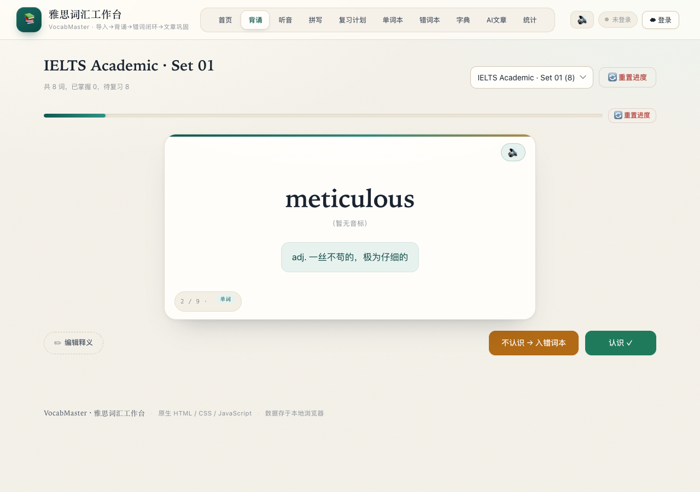

# 雅思词汇工作台 · VocabMaster

> 一个把「导入 → 背诵 → 听音 → 拼写 → 错词闭环 → 文章巩固」串成完整学习回路的雅思词汇工具。
> 原生 HTML / CSS / JavaScript 构建，零框架、零构建步骤，可选云端同步。

**Live Demo** · https://ielts-vocab-workbench-97952.app.workbuddy.host/



---

## 为什么做这个

市面上的背单词 App 大多把「背」和「用」拆开：今天背完，明天在阅读里遇到还是不认识。
这个项目想验证一件事——**如果词汇工具能从「我拼错了什么」出发，而不是从「今天该背第几页」出发，记忆效率会不会更高。**

于是有了这套闭环：

1. 粘贴任意词表（单词 / 短语 / 整句都能识别）
2. 认识的一次过，不认识的立刻进错词本
3. 错词必须**再连续答对 2 次**才算通过，中途拼错就清零重来
4. 系统按 1 / 2 / 4 / 7 / 15 / 30 天自动排复习
5. 最后用你的生词现场拼一篇阅读文章，把词放回语境里

## 功能

| 模块 | 说明 |
| --- | --- |
| **导入** | 一行一个词条，`单词#释义` 即可；支持短语与整句，缺释义时用内置词典补全，绝不跳过任何一行 |
| **背诵** | 词卡 + 英式发音，认识 / 不认识双键操作，第一次答对即通过 |
| **听音辨义** | 只放声音不显示拼写，先自评再揭示释义，想错了可以重判 |
| **拼写** | 看中文写英文，可限定「今日到期 / 错词本 / 全部 / 指定单词本 / 按本筛选错词」 |
| **错词本** | 按单词本归类，记录来源、复习阶梯与连续答对次数，连续 3 次答对毕业 |
| **复习计划** | 艾宾浩斯阶梯自动排程，今日到期一目了然，拼错回到第 1 阶 |
| **字典** | 自建词库，导入时优先命中，支持单词 / 短语分类与 CSV 导出 |
| **文章生成** | 基于雅思写作高频句型 + 你的词库实时拼装阅读材料（纯本地算法，无需 API Key），文中生词可点击查看释义 |
| **统计** | 单词本数、累计词汇、已掌握、错词待毕业等指标 |
| **云同步**（可选） | Supabase 邮箱登录，多设备共享单词本与进度；不登录也能完整使用 |
| **本地备份** | 一键导出 JSON；Chrome / Edge 下可绑定本地文件夹，自动落盘 `vocab-data.json` |

## 设计说明

v6.7 做了一次完整的视觉重做，目标是让工具"拿得出手"——能直接放进作品集，而不是一张工程师自用的表格。

- **Editorial Study Desk**：暖纸底色 + 墨绿主色 + 铜金点缀，替代原本通用的靛蓝 SaaS 配色
- **字体配对**：衬线体承担标题与词条（阅读感、学术感），系统无衬线体承担界面控件（清晰、密度高）
- **层次**：细边框 + 分层阴影，卡片悬停轻微上移；顶部导航改为分段式控件
- **细节**：纸纹噪点、进度条光泽、静音提示条、空状态占位
- **不改功能**：整轮改版只动 CSS 与少量语义化标签，所有 `id` / `class` / 事件绑定与数据流保持不变

无障碍与工程细节：键盘焦点可见、`prefers-reduced-motion` 降级、移动端标签横向滚动、无横向溢出。

## 线上地址（当前生效）

**https://ielts-vocab-workbench-97952.app.workbuddy.host/**

> 旧地址 `https://29434aabec424d5f960282f5c0ffa5a2.app.workbuddy.link/` 已无法从本工作区更新，代码停留在旧版本，请勿再使用。

云端数据托管在同一个 Supabase 项目（ref `fheznzjgwxyqtpdezwny`），页面内「云同步」登录后可在多设备同步单词本、错词本与学习进度。

## 技术栈

- **前端**：原生 HTML / CSS / JavaScript（ES2020），无框架、无打包器、无依赖
- **存储**：`localStorage`（本地优先，离线可用）
- **云同步（可选）**：Supabase REST + RLS，自写零依赖 fetch 封装，含 JWT 过期自动刷新与重试
- **本地开发**：Node 原生 `http` 静态服务器

### 目录结构

```
vocab-platform/
├── index.html          # 单页骨架（10 个功能面板 / 弹窗 / 气泡）
├── styles.css          # 全部样式与设计令牌
├── app.js              # 业务逻辑：队列、通过规则、SRS、渲染
├── data.js             # 内置词典与示例词库
├── supabase.js         # Supabase REST 封装（登录 / 刷新 / CRUD）
├── sync.js             # 云端同步编排（并发 + 冲突合并）
├── server.js           # 本地静态服务器
└── supabase/           # 建表 SQL 与 RLS 策略
```

### 两个值得一提的实现

**通过规则 `PassRule`（v6.2）**
单一状态机管理背诵 / 拼写 / 听音三种模式：`{ 已连续答对, 本次要求 }`。
只在答错时建记录、通过即删除——于是"存在记录"本身就等价于"这个词还没过"，进度统计不需要额外字段。
答错的卡会重新入队，因此队列允许重复项；通过时清理队尾副本，避免重复计数。

**同步不是"先删后插"**
早期版本整本覆盖写入，一旦请求中断就会把整本书清空。现在改为 `upsert` 后再清理多余行，
单本书失败只标记 `partial`，不影响其余数据；分页拉取突破 Supabase 默认 1000 行上限。

## 本地运行

```bash
node server.js
# 打开 http://127.0.0.1:8765
```

无需安装依赖，无需环境变量。纯静态目录也可以用任意静态服务器托管。

## 部署

静态站，可直接放到 Vercel / Netlify / Cloudflare Pages / GitHub Pages：

- 构建命令：留空
- 发布目录：仓库根目录
- 环境变量：默认无需（启用云同步时才需要 Supabase URL 与 anon key）

> 仓库内 `render.yaml` 提供了 Render 蓝图配置。

## 数据与隐私

- 学习数据默认**只存在浏览器 localStorage**，不上传任何服务器
- 云同步为可选功能，需自行登录；Supabase 端启用了行级安全策略（RLS），用户只能读写自己的数据
- 客户端只使用 `anon public` key（设计上可公开），`service_role` 密钥从不进入前端

## Roadmap

- [ ] 导入 Anki / CSV 词表
- [ ] 词根词缀与同义词关联
- [ ] 学习热力图与长期趋势
- [ ] 移动端 PWA（离线安装）
